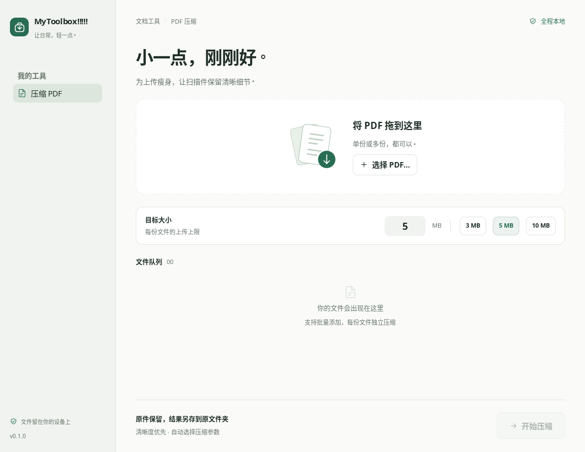

# MyToolbox!!!!!

一个完全使用 **[MyGo Native](https://github.com/egoist/mygo)** 构建的本地桌面工具箱。
界面、插画、控件和动效都由 Go 的 `ui` 包绘制，工具以独立模块注册。

第一个工具：**按目标大小批量压缩 PDF**，适合 iPhone 扫描件和网站上传限制。



[深色界面](docs/previews/dark.png) · [原生动效演示（示例状态）](docs/previews/motion.gif)

## 使用

1. 拖入一份或多份 PDF，也可以点击「选择 PDF…」。
2. 输入每份文件的大小上限，或选择 3 / 5 / 10 MB。
3. 点击「开始压缩」，完成后直接打开结果。

- 全程本地、可离线使用；正式构建随包附带压缩引擎。
- 每份文件独立处理；一份失败不会中断其他文件。
- 从较高画质逐步尝试，达到目标后立即停止。默认图片分辨率下限为 150 DPI。
- 达不到目标时保留较清晰的较小结果，按需选择「继续压缩（降低画质）」。
- 默认另存为 `原名_compressed.pdf`；重名自动编号，原件与既有结果完整保留。
- 已符合上限的文件直接使用原件；可取消任务，已完成的结果保留。
- 保留原有文字层的处理路径，不将整页栅格化；兼容性仍取决于原 PDF 的内容。
- 1 MB = 1,000,000 字节，压缩器预留 1% 空间以适应严格上传限制。

可读性取决于原始扫描质量、文字大小和页数，150 DPI 是保守策略而非自动可读性检测。
PDF 重写可能改变表单、注释、特殊交互和数字签名；签名文档请保留原件使用。
加密 PDF 会提示先解锁；损坏或不支持的文件单独报错。

## 平台与构建状态

| 平台 | 架构 | 构建方式 |
| --- | --- | --- |
| macOS 12+ | Apple Silicon / Intel | 原生 runner 构建引擎和 `.app` / `.dmg` |
| Windows 10/11 | x64 | 官方 x64 引擎，原生应用及安装包 |
| Linux | x64 / ARM64 | 原生 runner 构建引擎，归档及 `.deb` |

Linux 需要 GTK 3 与 OpenGL 运行库；默认构建 runner 为 Ubuntu 24.04。
Windows 版本使用 x64 引擎；首版没有 Windows ARM64 原生安装包。
macOS 和 Windows 的公开分发签名需要后续配置证书。

当前已在 Linux 实际运行、打包，并完成三个系统五个架构组合的应用交叉编译；
macOS / Windows 的原生运行和安装包验证由组织仓库中的构建流程继续执行。

## 开发

需要 Go **1.27.3+**。原生界面开发只需 Go；压缩还需本地 Ghostscript。

```sh
git clone https://github.com/nerv-base/MyToolbox.git
cd MyToolbox
go run .
# 或使用原生开发模式
go tool mygo dev
```

开发环境可安装系统 Ghostscript，或通过 `MYTOOLBOX_GS` 指定可执行文件。
构建正式包时使用下面的固定版本准备脚本，确保用户安装后离线可用。

### 构建完整离线应用

在目标系统和架构上执行，需要 Python 3.12+。
macOS / Linux 需要 C 编译器与 make；Windows 需要 PATH 中的 `7z`。

```sh
python scripts/prepare_engine.py
python scripts/collect_licenses.py
go tool mygo build
```

引擎固定为 Ghostscript 10.08.0，下载采用固定 SHA-512 校验。
引擎放入 `resources/<os>-<arch>/ghostscript/`，MyGo 负责平台资源合并与打包。
构建产物在 `build/`，对应引擎源码位于 `build/sources/`，分发时一并提供。

[Build desktop apps](.github/workflows/build.yml) 支持手动触发和 `v*` 标签触发，
在五个原生 runner 上构建完整离线应用、收集许可证及对应源码，上传构建产物。
该流程上传到 Actions artifacts，发布正式 Release 时应同时附上源码。
发布新版本前同步更新 `mygo.json` 的版本。

### 验证

```sh
go test -race ./...
go vet ./...
go tool mygo vet
CGO_ENABLED=0 go build .
```

测试包含真实扫描 PDF 压缩、文字层保留、画质边界、取消清理、重名保护、
批量失败隔离，以及 MyGo 原生 UI 的点击交互与减少动态效果。
真实压缩测试在找到 Ghostscript 时运行；CI 会安装或准备引擎。

生成应用图标与界面预览：

```sh
go generate .
MYTOOLBOX_PREVIEW="$PWD/build/previews" go test . -count=1
```

动效演示帧可通过 `MYTOOLBOX_MOTION_PREVIEW="$PWD/build/motion-frames" go test
./internal/tools/pdfcompress -run TestNativeMotionStoryboard -count=1` 导出。
该演示使用示例界面状态，压缩效果由独立的真实引擎测试验证。

## 扩展工具

参见 [模块架构](docs/architecture.md) 与 [界面和动效规范](docs/design.md)。
新增工具在独立包中实现 `toolbox.Tool`，然后在应用入口注册，随新版一起发布。
各工具可以自由构建原生界面，并复用统一的设计、文件选择和后台更新能力。

## 开源许可

**AGPL-3.0-only**。Ghostscript 也采用 AGPL 分发。
完整条款见 [LICENSE](LICENSE)，依赖与对应源码说明见 [THIRD_PARTY_NOTICES.md](THIRD_PARTY_NOTICES.md)。
